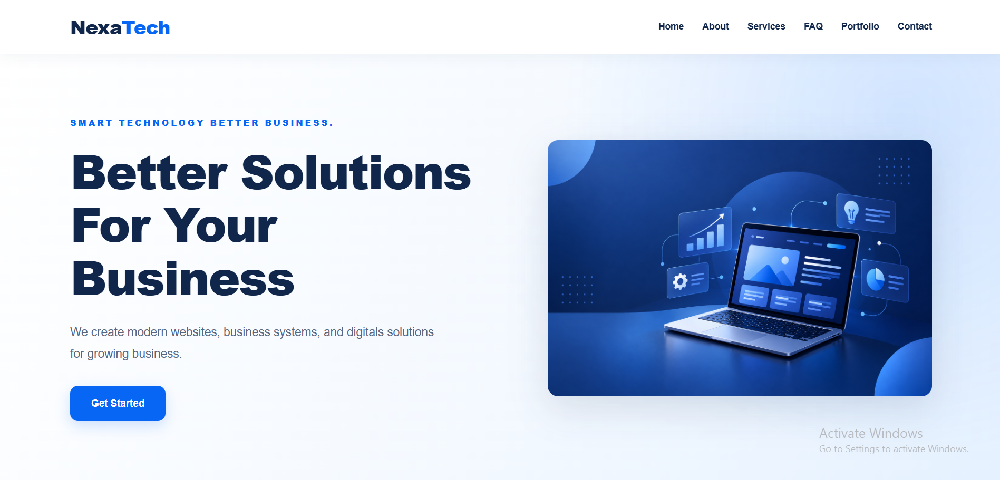
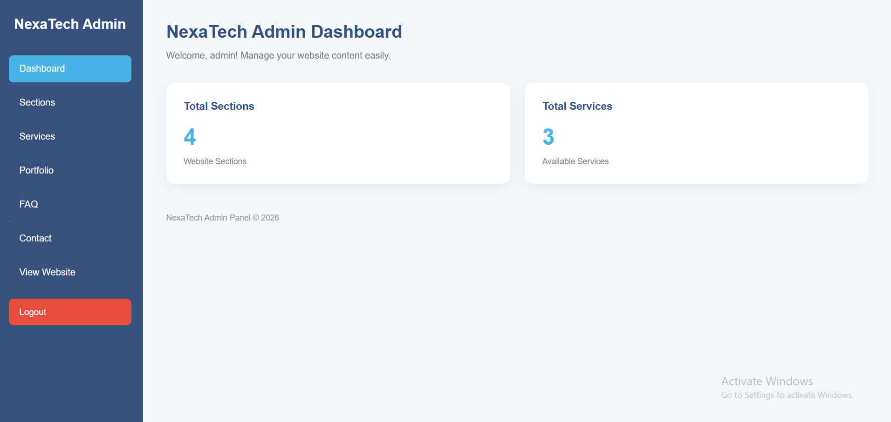

# NexaTech — Business Portfolio Website

A dynamic business portfolio website built with PHP, MySQL, HTML, CSS, and JavaScript.

Developed as part of my Web Development Internship at Violet Programming.

## Project Overview

NexaTech is a responsive business website designed to present company information, services, portfolio projects, and contact details.

The website includes a database-driven frontend and an administrative dashboard for managing website content.

## Features

### Public Website

- Responsive homepage and navigation
- Hero and About sections
- Dynamic services section
- Portfolio gallery with category filters
- Frequently Asked Questions (FAQ)
- Contact information
- Content retrieved from MySQL

### Admin Dashboard

- Admin login interface
- Dashboard for content management
- Manage website sections
- Add, edit, and delete services
- Update company information
- Manage content visibility

## Screenshots

### Website Homepage

### Admin Dashboard

## Technologies Used

- PHP
- MySQL
- HTML5
- CSS3
- JavaScript
- XAMPP
- phpMyAdmin
- Git & GitHub

## Database Structure

The application uses a MySQL database named `business_portfolio_db`.

Main tables:

- `sections` — Stores website sections and content.
- `services` — Stores service information and display order.
- `company_info` — Stores company contact details.

## Installation and Setup

### Requirements

- XAMPP
- PHP
- MySQL
- Web browser

### Steps

1. Install and open XAMPP.
2. Start Apache and MySQL.
3. Clone or download this repository.
4. Place the project folder inside `C:\xampp\htdocs\`.
5. Open phpMyAdmin at `http://localhost/phpmyadmin`.
6. Create a database named `business_portfolio_db`.
7. Import the project's SQL database export, if available.
8. Configure the local database connection in `includes/db.php`.
9. Open the project in your browser.

### Website

`http://localhost/business-portfolio/`

### Admin Dashboard

`http://localhost/business-portfolio/admin/`

The exact local URL depends on the project folder name.

## My Contribution

During my internship at Violet Programming, I worked on:

- Developing the responsive frontend.
- Integrating PHP with MySQL.
- Creating dynamic website sections.
- Building the services and portfolio interfaces.
- Implementing the FAQ section.
- Developing administrative content management features.
- Debugging PHP and database errors.
- Improving page layouts and responsiveness.

## Technical Challenges

### Database-Driven Content

Connected the frontend to MySQL so website content could be managed dynamically.

### Responsive Layout

Improved CSS layouts to maintain consistent spacing and presentation across screen sizes.

### Content Management

Implemented administrative features for updating website sections and services.

## What I Learned

- PHP and MySQL integration
- Dynamic website development
- CRUD operations
- Responsive CSS design
- Admin dashboard development
- Debugging and troubleshooting
- Git and GitHub workflows

## Project Status

Completed as an internship project.

The application runs locally using XAMPP, PHP, and MySQL.

## Developer

**Sally Kadi**

Junior PHP Full-Stack Developer | PHP, MySQL & JavaScript

- Portfolio: https://sally-kadi.github.io/sally-portfolio/
- GitHub: https://github.com/sally-kadi
- LinkedIn: https://www.linkedin.com/in/sally-kadi/
